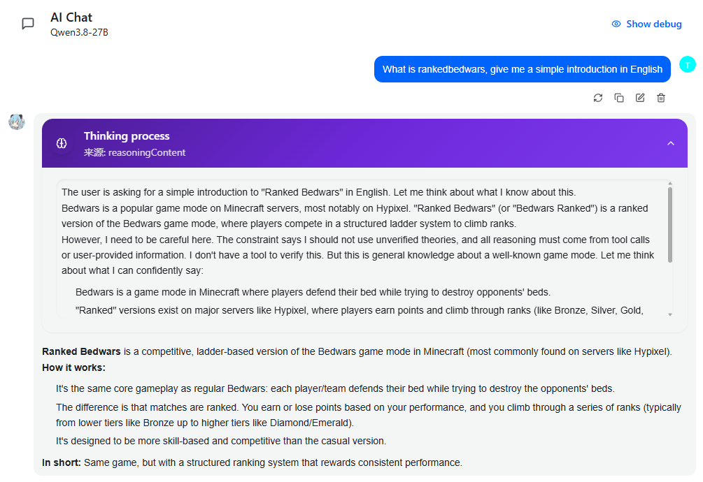
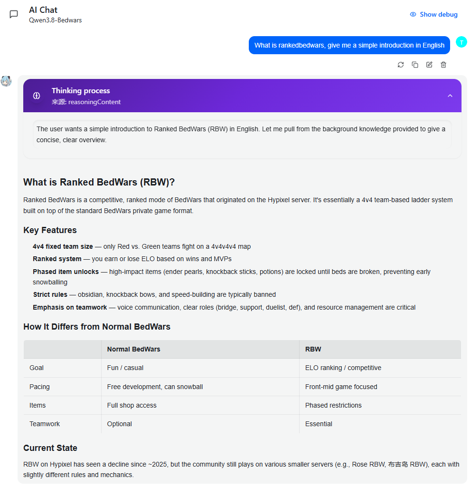

# RAG Proxy

Nowadays, every client seems to embed its own RAG. When multiple clients are enabled at the same time, they cannot share a single knowledge base at all. Even worse, RAG integrations are all over the place: every vendor has its own knowledge base, and some tools use MCP directly. So why not put a Proxy in front of the AI? This makes it easier for coding tools to read Maven documentation and helps chat agents learn specialized knowledge, such as the latest memes and slang, instead of relying only on their built-in parameters. That is why I built this project.

<p align="center">
  <a href="README.md">English</a> | <a href="README.zh-CN.md">中文</a>
</p>

A **knowledge-base proxy** that sits between your downstream application and upstream LLMs. It intercepts requests, retrieves relevant context from configured knowledge bases, and injects it into the prompt — giving any LLM domain-specific expertise without fine-tuning.

This add-on can dramatically multiply an AI model's expertise in a specific domain: even a standard Qwen3.8-27B can write Spigot plugins smoothly with the right knowledge base. I do not particularly like using AI to write plugins, but AI assistance is very convenient for understanding APIs and parameters. It can also be deployed locally, providing strong security and privacy.

For example, you can download the full [CookLikeHOC](https://github.com/Gar-b-age/CookLikeHOC) collection, import and index its recipe documents as a knowledge base, and route your own agent to it — turning your agent into a super chef with a whole cookbook at its fingertips.

**No local model dependencies.** Embedding, ReRank, and LLM inference all run through remote APIs. No `torch`, `transformers`, or `onnxruntime` in the container.

---

## Features

- **Model-name routing** — assign knowledge bases to model names; downstream clients just swap the `model` field. No code changes, no extra headers.
- **Multi-KB merge strategies** — `priority`, `concat`, or RRF (Reciprocal Rank Fusion) to combine results from multiple knowledge bases.
- **Zero local inference** — built-in pure-Python vector store (numpy cosine + JSONL/npy); optional Chroma Server via HTTP for larger deployments.
- **Web management panel** — manage providers, knowledge bases, model mappings, view request logs and analytics.
- **OpenAI & Anthropic compatible** — `POST /v1/chat/completions` and `POST /v1/messages` with SSE streaming support.
- **Graceful degradation** — retrieval failures fall back to transparent pass-through; conversations never break.
- **Docker or bare-metal** — multi-stage Docker build or `python -m ragproxy`.

---

## Before and After

The same question, with and without a domain-specific knowledge base:

| Without RAG | With RAG |
|-------------|----------|
|  |  |

---

## Tech Stack

| Layer | Choice |
|-------|--------|
| Backend | Python 3.11+ / FastAPI / Uvicorn |
| Frontend | Vue 3 + Vite + Element Plus (compiled to `static/`, served by FastAPI) |
| Vector Store | Built-in pure-Python (numpy cosine + JSONL/npy); optional Chroma Server (HTTP) |
| Deploy | Docker (multi-stage) or bare-metal `python -m ragproxy` |

> **Why not embedded Chroma?** `chromadb` hard-depends on `onnxruntime` (its built-in embedding uses ONNX models), conflicting with the zero-local-inference constraint. The default implementation is a lightweight built-in vector store. A `chroma_http` backend is available for connecting to a standalone Chroma Server.

---

## Quick Start

### Docker

#### Install from the command line

```bash
docker pull ghcr.io/trystage/rag-proxy:latest
```

```bash
docker run -d -p 8100:8100 -v ./data:/data ghcr.io/trystage/rag-proxy:latest
```

#### Build locally

```bash
docker compose up -d --build
# or
docker build -t rag-proxy . && docker run -d -p 8100:8100 -v ./data:/data rag-proxy
```

On first start, `/data/config/config.yaml` is created with sensible defaults and a panel secret key is generated (written to `/data/config/secret_key.yaml` and printed in the startup log). **Backup = tar the `./data` directory.**

### Bare-metal

```bash
pip install -r requirements.txt
python -m ragproxy                          # data dir defaults to ./data
python -m ragproxy --data-dir /var/lib/ragproxy --port 8100
```

### Environment Variables

| Variable | Description | Default |
|----------|-------------|---------|
| `RAGPROXY_DATA_DIR` | Data root directory | Docker: `/data`, bare-metal: `./data` |
| `RAGPROXY_PORT` | Listen port | `8100` |
| `RAGPROXY_HOST` | Bind address | `0.0.0.0` |
| `RAGPROXY_LOG_LEVEL` | Log level | `INFO` |
| `RAGPROXY_CONFIG` | Config file path | `<DATA_DIR>/config/config.yaml` |
| `RAGPROXY_SECRET_KEY` | Panel login key | Auto-generated on first start |
| `TZ` | Timezone | `UTC` |

Priority: **CLI args > env vars > config file > defaults**

---

## Data Directory Layout

```
<DATA_DIR>/
├── config/
│   ├── config.yaml              # All business config (hot-reload via Web UI)
│   └── secret_key.yaml          # Panel login key (auto-generated)
├── vectordb/                    # Vector store persistence (<kb>/chunks.jsonl + vectors.npy)
├── documents/<kb_name>/         # Uploaded source docs (uuid-renamed) + manifest.json
├── cache/embedding/ + cache/rerank/   # Disk caches for embedding / rerank calls
└── logs/
    ├── rag-proxy.log            # Application log (rotating)
    └── requests.db              # Request log (SQLite, feeds the dashboard)
```

---

## Configuration (`config.yaml`)

All business settings live in `config.yaml`. Changes saved via Web UI trigger **hot-reload** — no container restart needed.

### Choosing a Vector Store

The built-in `simple` store is light and needs no extra service, so it is a good choice for a small project on one machine. For a large project or several users, run Chroma separately and use its HTTP API:

```yaml
vectorstore:
  type: "chroma_http"
  chroma_http:
    base_url: "http://chroma:8000"
    tenant: "default_tenant"
    database: "default_database"
    collection_prefix: "ragproxy_"
```

The proxy does not start Chroma for you. Keep the Chroma Server data and backups separate from the proxy data.

### Model → Knowledge Base Mapping

```yaml
models:
  - name: "qwen3-8b"              # The model field in downstream requests
    kb: null                      # null = no retrieval, pass-through
    upstream: "local-qwen"
  - name: "qwen3-8b-mc"
    kb: ["minecraft-wiki", "bedwars-kb"]
    kb_merge: "concat"            # priority | concat | rrf
    upstream: "local-qwen"
    inject_mode: "system_prepend" # system_prepend | system_append | new_message
    rerank: true
```

Downstream clients simply use the mapped `model` name — no code changes or extra headers required.

### Choosing an Injection Mode

Set `inject_mode` in the model mapping to choose where retrieved knowledge is placed. All three modes preserve the original user messages and conversation history.

| Mode | Placement | Suggested use and benefits |
|------|-----------|----------------------------|
| `system_prepend` (default) | Insert a new system message before the first system message | A general default when the model should see the knowledge-base background at the beginning without changing the client's original system prompt. This does not guarantee that the model gives it higher priority. |
| `system_append` | Append retrieved content to the first system message | Short conversations, one-off questions, or clients that prefer a single combined system message. Keeps the original prompt and retrieved knowledge together without adding another message. |
| `new_message` | Add a new system message at the end of the message list | Upstreams that support shared-prefix prompt caching and accept a trailing system message. Changing retrieval content stays at the end, leaving the earlier system prompt and history unchanged and potentially allowing cached prefixes to be reused. |

Notes:

- The first two modes only act on the **first system message**, leaving any later system messages unchanged. If there is no system message, they insert one at the beginning.
- `new_message` does not guarantee a cache hit. Results depend on the upstream's caching rules, minimum length, and exact prefix matching. Some upstreams do not accept a trailing system message; check compatibility first.
- With `system_prepend` and `system_append`, changing retrieval content near the start of the request may reduce shared-prefix cache reuse.
- `{query}` is replaced in all three modes without overwriting the original user message. Remove `User content: {query}` from the injection template if you do not want to repeat the question.

### Multi-KB Merge Strategies

| Value | Behavior |
|-------|----------|
| `priority` | Query KBs in array order; skip remaining if earlier KB returns enough results |
| `concat` | Query all KBs, merge results, sort by score |
| `rrf` | Reciprocal Rank Fusion across all KBs |

### Retrieval & Injection

```yaml
rag:
  inject_template: |
    Below is reference material related to the user's content. Please use it to answer:

    {context}

    ---
    User content: {query}
  max_context_tokens: 2000   # Truncate injected context by token count
  top_k: 5
  score_threshold: 0.7
  rerank_top_k: 10
  query_source: "last_user"  # last_user | last_message | all_user
```

Retrieved content is explicitly labeled as "reference material" to separate it from instructions (prompt-injection defense).

---

## API Reference

The proxy maintains the same API contract as downstream clients — it only performs model selection, KB merge, and re-ranking. **No format translation** (OpenAI requests route to `type: openai` upstreams, Anthropic to `type: anthropic`).

| Endpoint | Description |
|----------|-------------|
| `POST /v1/chat/completions` | OpenAI-compatible, supports `stream` (SSE pass-through) |
| `GET /v1/models` | Returns the list of configured models |
| `POST /v1/messages` | Anthropic-compatible, supports `stream` |
| `GET /health` | Health check |

### Example (OpenAI format)

```bash
curl http://127.0.0.1:8100/v1/chat/completions \
  -H 'Content-Type: application/json' \
  -d '{"model": "qwen3-8b-mc", "messages": [{"role": "user", "content": "What does a redstone repeater do?"}]}'
```

Downstream API-key authentication is enabled by default. Set `api_keys` in `config.yaml`, then send `Authorization: Bearer <key>`. To explicitly allow anonymous downstream access, set `api_key_auth: false`.

**Failure handling:** retrieval / vector-store / embedding failures degrade to transparent pass-through (conversation continues); upstream failures return a clean error (no traceback in production).

---

## Web Management Panel

Open `http://<host>:8100` in a browser. Log in with the panel secret key (env `RAGPROXY_SECRET_KEY`, or the value in `data/config/secret_key.yaml`; also printed in the startup log on first run).

| Module | Capabilities |
|--------|-------------|
| Dashboard | Request volume, hit rate, avg retrieval latency, 24h trends, per-model / per-KB stats |
| Providers | CRUD for LLM / Embedding / ReRanker / VectorStore providers, connection test |
| Knowledge Bases | Create, drag-and-drop upload (multi-file / folder / archive auto-extract), chunk preview, reindex, delete, retrieval test |
| Model Mappings | CRUD for model-name → KB + upstream bindings |
| Request Logs | Filter by time / model / KB, view query preview and matched docs |
| Settings | Edit `config.yaml`; save triggers hot-reload |

---

## Document Upload

- **Formats:** Markdown / TXT / PDF / HTML / Word (`.docx`; legacy binary `.doc` must be converted first)
- **Limits:** per-file size, batch count, and batch total size are configurable (defaults: 100 MB / 500 files / 2 GB)
- **Archives:** `zip` / `tar.gz` are auto-extracted and batch-ingested
- **Manual:** drop files into `<DATA_DIR>/documents/<kb_name>/` then click "Reindex"
- **Chunking:** `token` (default) / `paragraph` / `heading` strategies; `chunk_size` / `chunk_overlap` tunable

---

## Security

- JWT auth on the admin panel; all admin API endpoints are authenticated
- Optional downstream API-key validation (`api_keys`)
- Upload filenames are uuid-renamed; extension whitelist; archive entries validated (rejects `..`, absolute paths, symlinks)
- Double size check before/after extraction (zip-bomb defense); concurrency limits on embedding and upload
- Config parsed with `yaml.safe_load`; retrieved content explicitly labeled as reference material (prompt-injection defense)
- Logging: newlines escaped in user I/O; full query not logged by default (enable via `security.log_query: true` or DEBUG level); API keys masked
- No tracebacks returned in production

---

## Running Tests

```bash
# End-to-end test (no external models needed, uses built-in mock upstream):
python3 tests/mock_upstream.py &            # port 9010
RAGPROXY_SECRET_KEY=test-secret-123 \
  python3 -m ragproxy --data-dir tests/.data --config tests/config_test.yaml --port 8100 &
python3 tests/e2e.py                        # 38 assertions: auth/KB/upload/zip/path-traversal/RAG injection/streaming/logging/stats/hot-reload/security
```

---

## Project Structure

```
rag-proxy/
├── ragproxy/
│   ├── cli.py / __main__.py      # python -m ragproxy entry point
│   ├── config.py                 # Config loading (CLI > env > yaml > defaults) + hot-reload
│   ├── state.py                  # Global state assembly
│   ├── security.py               # JWT / key validation
│   ├── providers/                # LLM / Embedding / ReRanker / VectorStore
│   ├── rag/                      # Chunking / injection / ingestion / orchestration
│   ├── api/                      # Public API + admin API
│   ├── services/                 # Request logging / statistics
│   └── utils/                    # Safe extraction / text extraction / token estimation
├── frontend/                     # Vue3 + Vite + Element Plus source
├── static/                       # Frontend build output (served by backend)
├── data/                         # Runtime data (auto-initialized on first start)
├── tests/                        # Mock upstream + e2e tests
├── Dockerfile / docker-compose.yml
└── requirements.txt
```

---

## Known Limitations

- Legacy `.doc` (binary format) and scanned PDFs without a text layer cannot be parsed; convert beforehand
- The built-in vector store is suited for single-node, medium-scale knowledge bases; for large-scale retrieval, switch to a standalone Chroma Server
- Anthropic-format requests: injected context is merged into the `system` field (the Anthropic protocol has no message-level system injection)
