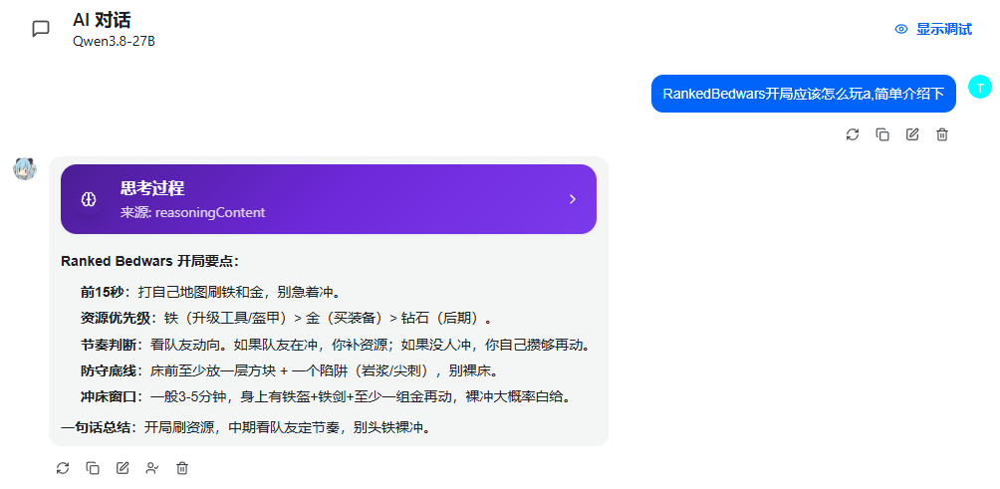
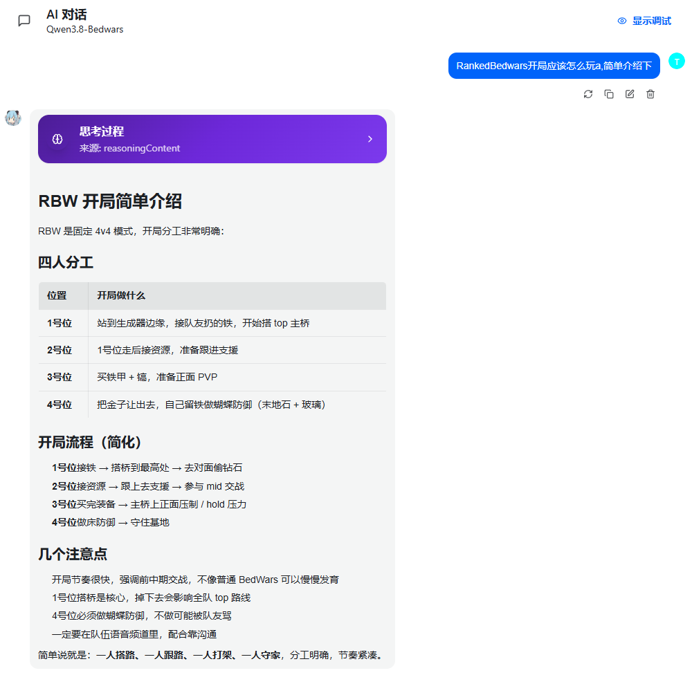

# RAG Proxy

现在每个客户端都喜欢内嵌自己的 RAG，同时开启多个客户端时，它们根本没法共用同一个知识库。更麻烦的是，RAG 的接入方式五花八门，每家都有自己的知识库，甚至还有直接使用 MCP 的。那我们为什么不能在访问 AI 之前加一层 Proxy？这样一来，写代码的工具可以更方便地读取 Maven 文档，聊天 Agent 也能更好地学习各种专项知识，例如随时了解最新的梗和 slang，而不是只依赖模型自身的参数来回答问题。因此，我搬出了这个项目。

<p align="center">
  <a href="README.md">English</a> | <a href="README.zh-CN.md">中文</a>
</p>

**知识库中间层代理**：在请求转发到上游 LLM 之前，按**模型名**加载中间知识库，检索结果注入 prompt，实现不训练 LoRA 的专项能力增强。带 Web 管理后台，可管理多知识库、多 Provider。

这个外挂可以让 AI 的专项能力大幅增强，甚至翻倍。例如，普通的 Qwen3.8-27B 配合合适的知识库，也可以非常流畅地编写 Spigot 插件。项目支持本地部署，安全性和隐私性都很高。

**零本地模型依赖。** Embedding、ReRank、LLM 推理全部通过远程接口调用；容器内无 `torch`、`transformers`、`onnxruntime`，无模型文件。

---

## 功能特性

- **模型名路由** — 为模型名绑定知识库，下游客户端只需替换 `model` 字段即可。无需改代码、无需加 header。
- **多知识库合并策略** — `priority`、`concat` 或 RRF（倒数排名融合）三种方式合并多个知识库的检索结果。
- **零本地推理** — 内置纯 Python 向量库（numpy 余弦 + JSONL/npy）；可选 Chroma Server（HTTP）用于大规模部署。
- **Web 管理面板** — 管理 Provider、知识库、模型映射，查看请求日志和分析。
- **OpenAI & Anthropic 兼容** — 支持 `POST /v1/chat/completions` 和 `POST /v1/messages`，SSE 流式传输。
- **优雅降级** — 检索失败自动降级为透传，不会中断对话。
- **Docker 或裸机** — 多阶段 Docker 构建或 `python -m ragproxy`。

---

## 效果对比

同一个问题，在没有接入和接入专项知识库时的回答对比：

| 未接入 RAG | 接入 RAG |
|------------|----------|
|  |  |

---

## 技术栈

| 层 | 选型 |
|---|---|
| 后端 | Python 3.11+ / FastAPI / Uvicorn |
| 前端 | Vue 3 + Vite + Element Plus（编译到 `static/`，由 FastAPI 托管） |
| 向量存储 | 内置纯 Python 向量库（numpy 余弦 + JSONL/npy）；可选 Chroma Server（HTTP）用于大规模部署 |
| 部署 | Docker（多阶段构建）或裸机 `python -m ragproxy` |

> **为什么不用嵌入式 Chroma？** `chromadb` 将 `onnxruntime` 作为硬依赖（其内置 embedding 使用 ONNX 模型），与"零本地推理"约束冲突。因此默认实现为内置纯 Python 向量库，并预留 `chroma_http` 后端连接独立部署的 Chroma Server。

---

## 快速开始

### Docker 模式

#### 从命令行安装

```bash
docker pull ghcr.io/trystage/rag-proxy:latest
docker run -d -p 8100:8100 -v ./data:/data ghcr.io/trystage/rag-proxy:latest
```

#### 本地构建

```bash
docker compose up -d --build
# 或
docker build -t rag-proxy . && docker run -d -p 8100:8100 -v ./data:/data rag-proxy
```

首次启动自动创建 `/data/config/config.yaml`（内置默认配置）并生成面板密钥（写入 `/data/config/secret_key.yaml`，同时输出在启动日志）。**备份 = 打包 `./data` 目录。**

### 裸机模式

```bash
pip install -r requirements.txt
python -m ragproxy                          # 数据目录默认 ./data
python -m ragproxy --data-dir /var/lib/ragproxy --port 8100
```

### 环境变量

| 变量 | 说明 | 默认值 |
|------|------|--------|
| `RAGPROXY_DATA_DIR` | 数据根目录 | Docker: `/data`，裸机: `./data` |
| `RAGPROXY_PORT` | 监听端口 | `8100` |
| `RAGPROXY_HOST` | 监听地址 | `0.0.0.0` |
| `RAGPROXY_LOG_LEVEL` | 日志级别 | `INFO` |
| `RAGPROXY_CONFIG` | 配置文件路径 | `<DATA_DIR>/config/config.yaml` |
| `RAGPROXY_SECRET_KEY` | 面板登录密钥 | 首次启动自动生成 |
| `TZ` | 时区 | `Asia/Shanghai` |

优先级：**命令行参数 > 环境变量 > 配置文件 > 默认值**

---

## 数据目录结构

```
<DATA_DIR>/
├── config/
│   ├── config.yaml              # 全部业务配置（Web UI 读写，热重载）
│   └── secret_key.yaml          # 面板登录密钥（首次启动生成）
├── vectordb/                    # 向量库持久化（<kb>/chunks.jsonl + vectors.npy）
├── documents/<kb_name>/         # 上传的原始文档（uuid 重命名）+ manifest.json
├── cache/embedding/ + cache/rerank/   # embedding / rerank 磁盘缓存
└── logs/
    ├── rag-proxy.log            # 应用日志（滚动）
    └── requests.db              # 请求日志（SQLite，Dashboard 数据源）
```

---

## 业务配置（config.yaml）

所有业务配置集中在 `config.yaml`。通过 Web UI 保存后**热重载**，无需重启容器。

### 模型名 → 知识库映射

```yaml
models:
  - name: "qwen3-8b"              # 下游请求里的 model 字段
    kb: null                      # null = 不检索，直接转发
    upstream: "local-qwen"
  - name: "qwen3-8b-mc"
    kb: ["minecraft-wiki", "bedwars-kb"]
    kb_merge: "concat"            # priority | concat | rrf
    upstream: "local-qwen"
    inject_mode: "system_prepend" # system_prepend | system_append | new_message
    rerank: true
```

下游要 RAG 只需把请求里的 `model` 名换成对应名称，**不需要改代码、不需要加 header**。

### 多知识库合并策略

| 取值 | 行为 |
|------|------|
| `priority` | 按 kb 数组顺序，前一个 kb 命中足够时不再查后续 |
| `concat` | 所有 kb 分别检索后合并结果，按 score 排序 |
| `rrf` | Reciprocal Rank Fusion 融合多个 kb 的排名 |

### 检索与注入

```yaml
rag:
  inject_template: |
    以下是与用户内容相关的参考资料，请结合这些资料回答：

    {context}

    ---
    用户内容：{query}
  max_context_tokens: 2000   # 注入内容按 token 截断
  top_k: 5
  score_threshold: 0.7
  rerank_top_k: 10
  query_source: "last_user"  # last_user | last_message | all_user
```

检索内容显式标记为"参考资料"，与指令区分（Prompt 注入防护）。

---

## 开放接口

与下游 API 格式保持一致，内部只做模型选择、知识库合并、重排序，**不做 OpenAI ↔ Anthropic 格式转换**（OpenAI 格式请求只能路由到 `type: openai` 的 upstream，反之亦然）。

| 端点 | 说明 |
|------|------|
| `POST /v1/chat/completions` | OpenAI 兼容，支持 `stream`（SSE 透传） |
| `GET /v1/models` | 返回配置里定义的模型列表 |
| `POST /v1/messages` | Anthropic 兼容，支持 `stream` |
| `GET /health` | 健康检查 |

### 示例（OpenAI 格式）

```bash
curl http://127.0.0.1:8100/v1/chat/completions \
  -H 'Content-Type: application/json' \
  -d '{"model": "qwen3-8b-mc", "messages": [{"role": "user", "content": "红石中继器有什么用？"}]}'
```

可选下游 key 校验：在 `config.yaml` 的 `api_keys` 配置后，下游请求需携带 `Authorization: Bearer <key>`。

**故障降级**：检索 / 向量库 / embedding 故障时自动降级为透传，不阻断对话；上游故障时返回错误信息（生产环境不返回 traceback）。

---

## 管理面板

浏览器打开 `http://<host>:8100`，使用登录密钥（环境变量 `RAGPROXY_SECRET_KEY` 或 `data/config/secret_key.yaml` 中的值，首次启动也会打印在日志中）登录。

| 模块 | 功能 |
|------|------|
| 概览 | 请求量、命中率、平均检索耗时、24h 趋势、按模型/知识库统计 |
| Providers | LLM / Embedding / ReRanker / VectorStore 的 CRUD、连接测试 |
| 知识库 | 创建、拖拽上传（多文件/文件夹/压缩包自动解压）、分块预览、重建索引、删除、检索测试 |
| 模型映射 | model 名 → 知识库 + upstream 的 CRUD |
| 请求日志 | 按时间/模型/知识库筛选，查看 query 预览与命中 doc |
| 设置 | 编辑 config.yaml，保存即热重载 |

---

## 文档上传

- **格式**：Markdown / TXT / PDF / HTML / Word（`.docx`；旧版二进制 `.doc` 需先转换）
- **限制**：单文件上限、单次批量数量/大小均可配置，默认 100 MB / 500 个 / 2 GB
- **压缩包**：`zip` / `tar.gz` 自动解压后批量入库
- **手动写入**：直接写入 `<DATA_DIR>/documents/<kb_name>/` 后点"重建索引"
- **分块策略**：`token`（默认）/ `paragraph` / `heading`，chunk_size / chunk_overlap 可调

---

## 安全

- 管理面板 JWT 登录鉴权，管理 API 全部鉴权
- 下游 API 可选 key 校验（`api_keys`）
- 上传文件名 uuid 重命名、扩展名白名单、压缩包逐 entry 校验路径（拒绝 `..` / 绝对路径 / 链接）
- 解压前后大小双重校验（防 zip bomb）、embedding 与上传并发限制
- 配置仅 `yaml.safe_load`；检索内容显式标记为参考资料（Prompt 注入防护）
- 日志：用户输入输出转义换行；默认不记录完整 query（`security.log_query: true` 或 DEBUG 级别才记）；API key 脱敏
- 生产环境不返回 traceback

---

## 运行验证

```bash
# 端到端验证（无需任何模型，使用内置 mock 上游）：
python3 tests/mock_upstream.py &            # 端口 9010
RAGPROXY_SECRET_KEY=test-secret-123 \
  python3 -m ragproxy --data-dir tests/.data --config tests/config_test.yaml --port 8100 &
python3 tests/e2e.py                        # 38 项断言：登录/鉴权/KB/上传/zip 解压/越界防护/RAG 注入/流式/日志/统计/热重载/安全
```

---

## 项目结构

```
rag-proxy/
├── ragproxy/
│   ├── cli.py / __main__.py      # python -m ragproxy 入口
│   ├── config.py                 # 配置加载（CLI > env > config.yaml > 默认）+ 热重载
│   ├── state.py                  # 全局状态装配
│   ├── security.py               # JWT / 密钥校验
│   ├── providers/                # LLM / Embedding / ReRanker / VectorStore
│   ├── rag/                      # 分块 / 注入 / 摄取 / 编排
│   ├── api/                      # 开放接口 + 管理 API
│   ├── services/                 # 请求日志 / 统计
│   └── utils/                    # 安全解压 / 文本提取 / token 估算
├── frontend/                     # Vue3 + Vite + Element Plus 源码
├── static/                       # 前端构建产物（后端托管）
├── data/                         # 运行时数据（首次启动自动初始化）
├── tests/                        # mock 上游 + e2e 验证
├── Dockerfile / docker-compose.yml
└── requirements.txt
```

---

## 已知边界

- 旧版 `.doc`（二进制）与扫描版 PDF 无文字层时无法解析文本，需先转换
- 内置向量库适合单机中小规模知识库；超大规模检索建议切换独立 Chroma Server
- Anthropic 格式请求的注入统一合并到 `system` 字段（Anthropic 协议无 message 级 system 注入）
- 本仓库未包含 CI；Dockerfile 前端构建产物需在具备 Node 的构建环境生成（镜像内多阶段已包含）
